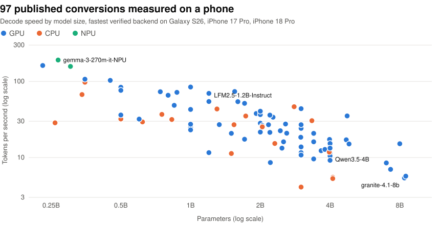

# hf-to-litertlm

Convert open-weight Hugging Face LLMs and VLMs into `.litertlm` bundles for Google's LiteRT-LM runtime (Android, iOS, macOS, Windows, Linux). There are 114 published conversions below, most with speeds measured on a phone and a Mac.

<p align="center">
<picture>
  <source media="(prefers-color-scheme: dark)" srcset="https://raw.githubusercontent.com/john-rocky/hf-to-litertlm/main/docs/images/speed-dark.svg">
  
</picture>
</p>

If you want an open model in an Android or iPhone app, look for it in the [list of converted models](#converted-models) first. If it isn't there, [ask for it](https://github.com/john-rocky/hf-to-litertlm/issues/new?template=model-request.yml) with the model's Hugging Face link. I reply on the issue with the bundle, the recipe and the measured numbers, or the reason it couldn't be converted. Two SDKs already load these files by repo name: [react-native-litert-lm](https://github.com/hung-yueh/react-native-litert-lm) and [flutter_edge_ai](https://github.com/DenisovAV/flutter_edge_ai).

## Try a published model

On a Mac, before it goes on a phone (needs [uv](https://docs.astral.sh/uv/)):

```bash
uvx litert-lm@0.18.0 run \
  --from-huggingface-repo=litert-community/LFM2.5-1.2B-Instruct \
  LFM2.5-1.2B-Instruct_int4_gpu.litertlm \
  --prompt="What is 17 + 25? Answer briefly."
```

To use a published bundle in an Android app, add [hfmodels-android](https://github.com/john-rocky/hfmodels-android) with one Gradle dependency and a few lines of Kotlin ([code](docs/apps.md#android)). In an iPhone app, it loads through [swift-litert-lm](https://github.com/john-rocky/swift-litert-lm) ([code](docs/apps.md#iphone)).

## Convert a finetune

```bash
uvx hf-to-litertlm <org>/<model>
```

That runs `convert.py` from PyPI and writes the bundle under `./out`. The hybrid families (granite-4.0-h, Falcon-H1, Zamba2 and Nemotron-H) need a clone, and the package tells you when:

```bash
git clone https://github.com/john-rocky/hf-to-litertlm
cd hf-to-litertlm
uv sync
uv run python scripts/convert.py <org>/<model>
uv run python scripts/verify_lock.py out/<model>/<model>.lock.json
uv run litert-lm run out/<model>/*.litertlm --prompt "Hello"
```

`verify_lock.py` rebuilds the bundle from its lock file and prints MATCH when the bytes are the same.

`convert.py` handles finetunes of Qwen3.5, LFM2.5, MiniCPM5, granite-4.0-h, Falcon-H1 and Nemotron-H, and every dense architecture the stock exporter handles. LoRA and PEFT repos merge automatically. It refuses gated, remote-code and pre-quantized repos and says why. It then asks the finished bundle 8 test questions and reports a failure if fewer than 6 are right. [All the flags and steps](docs/convert.md) are in the docs.

## Converted models

The list runs from LFM2.5-230M to Qwen3.5-122B-A10B: chat, reasoning, vision, OCR, speech to text and translation. Each speed is tokens per second on the fastest backend verified on that class of device, taken from the repo's `litertlm_manifest.json`. A range is the spread across runs, and a dash means not measured yet.

<details>
<summary>Show all the conversions</summary>

<!-- models-table:start -->
| Model | Params | Task | Phone: decode tok/s | Mac: decode tok/s | Recipe |
|---|---:|---|---|---|---|
| [LFM2.5-230M](https://huggingface.co/litert-community/LFM2.5-230M) | 0.23B | chat | iPhone 17 Pro GPU 161.7 | M4 Max GPU 561.2 | [recipe](REPRODUCE.md#lfm25-230m-the-smallest-decoder--a-template-the-runtime-cannot-parse-and-a-shape-that-kills-the-gpu-shader-compile) |
| [gemma-3-270m-it-NPU](https://huggingface.co/mlboydaisuke/gemma-3-270m-it-NPU-LiteRT) | 0.268B | chat, Qualcomm NPU only (compiled on the device) | Galaxy S26 NPU 190.8–192.9 | — | [recipe](REPRODUCE.md#gemma-3-270m-it-qualcomm-npu-srq-compiled-on-the-device--the-rope-ranges-raised-to-the-cache-end) |
| [MNN-Pocket-0.3B](https://huggingface.co/litert-community/MNN-Pocket-0.3B) | 0.303B | chat (en, zh), tool calls as JSON text | Galaxy S26 NPU 157.4–158.0 | M4 Max GPU 490.9 | [recipe](REPRODUCE.md#mnn-pocket-03b--a-03b-chatml-model-as-one-int8-file-litert-torchs-stock-export_hf-with-gpu-composites-prefill-signatures-of-128-and-1024-tokens-a-4096-token-kv-cache-the-source-tokenizerjson-and-a-chat-template-that-takes-content-parts-2026-11-06) |
| [granite-4.0-h-350m](https://huggingface.co/litert-community/granite-4.0-h-350m) | 0.35B | chat | Galaxy S26 CPU 97.6 | — | [recipe](REPRODUCE.md#granite-40-h-350m-fp16--int8--and-the-start_token-lesson) |
| [LFM2.5-350M](https://huggingface.co/litert-community/LFM2.5-350M) | 0.35B | chat | Galaxy S26 GPU 106.9 | M4 Max GPU 425.9 | [recipe](REPRODUCE.md#lfm25-350m--the-litert-lm-modelslfm2-configuration-replaces-the-vendor-template-and-the-4-section-export-needs-a-quantizer-that-keeps-every-section) |
| [Falcon-H1-0.5B-Instruct](https://huggingface.co/litert-community/Falcon-H1-0.5B-Instruct) | 0.5B | chat | Galaxy S26 CPU 32.1–40.5 | M4 Max GPU 127.5 | [recipe](REPRODUCE.md#falcon-h1-attention--mamba2-in-parallel-every-layer--first-fully-hybrid-family-in-litert-form) |
| [sarashina2.2-0.5b-instruct-v0.1](https://huggingface.co/litert-community/sarashina2.2-0.5b-instruct-v0.1) | 0.5B | chat, Japanese | Galaxy S26 GPU 36.2–36.5 | M4 Max GPU 197.8 | [recipe](REPRODUCE.md#sarashina22-05b--1b-instruct-sb-intuitions-japanese--a-sentencepiece-vocab-whose-chat-specials-are-control-pieces-and-a-bos-the-model-never-saw) |
| [LFM2-700M](https://huggingface.co/litert-community/LFM2-700M) | 0.74B | chat | Galaxy S26 GPU 73.2 | M4 Max GPU 348.3 | [recipe](REPRODUCE.md#lfm2-700m--the-first-generation-lfm2-template-fails-at-render-and-on-this-checkpoint-the-int8-file-keeps-the-exporters-default-recipe-convolutions-quantized) |
| [granite-4.0-h-1b](https://huggingface.co/litert-community/granite-4.0-h-1b) | 1B | chat | Galaxy S26 GPU 24.9 | M4 Max GPU 134.7 | [recipe](REPRODUCE.md#granite-40-h-mamba2--attention-hybrid--first-mamba2-hybrid-on-the-released-runtime) |
| [OLMo-2-1B-Instruct](https://huggingface.co/litert-community/OLMo-2-1B-Instruct) | 1B | chat | Galaxy S26 GPU 23.1 | M4 Max GPU 150.1 | [card](cards/olmo2-1b-litert.md) |
| [sarashina2.2-1b-instruct-v0.1](https://huggingface.co/litert-community/sarashina2.2-1b-instruct-v0.1) | 1B | chat, Japanese | Galaxy S26 GPU 27.4–27.5 | M4 Max GPU 159.4 | [recipe](REPRODUCE.md#sarashina22-05b--1b-instruct-sb-intuitions-japanese--a-sentencepiece-vocab-whose-chat-specials-are-control-pieces-and-a-bos-the-model-never-saw) |
| [LFM2.5-1.2B-Instruct](https://huggingface.co/litert-community/LFM2.5-1.2B-Instruct) | 1.2B | chat | Galaxy S26 GPU 54.5 | M4 Max GPU 318.3 | [recipe](REPRODUCE.md#lfm25-family-hybrid-shortconv--attention) |
| [LFM2.5-1.2B-JP](https://huggingface.co/litert-community/LFM2.5-1.2B-JP) | 1.2B | chat, Japanese | iPhone 17 Pro GPU 70.0 | M4 Max GPU 316.0 | [recipe](REPRODUCE.md#lfm25-family-hybrid-shortconv--attention) |
| [Zamba2-1.2B-instruct](https://huggingface.co/litert-community/Zamba2-1.2B-instruct) | 1.2B | chat | Galaxy S26 GPU 11.6 | M4 Max GPU 74.0 | [recipe](REPRODUCE.md#zamba2-mamba2-backbone--a-shared-lora-specialized-transformer-block--and-the-metaspace-tokenizer-trap) |
| [granite-3.0-1b-a400m-instruct](https://huggingface.co/litert-community/granite-3.0-1b-a400m-instruct) | 1.33B | chat, tool calling | Galaxy S26 GPU 27.1–27.4 | M4 Max GPU 146.2–146.5 | [recipe](REPRODUCE.md#granite-30-1b-a400m-instruct--a-32-expert-moe-with-silu-experts-every-expert-for-every-token-each-layers-experts-as-two-fully-connected-layers-the-decode-logits-padded-for-the-gpu-sampler-fp32-gpu-activations-declared-2026-10-21) |
| [Falcon-H1-1.5B-Deep-Instruct](https://huggingface.co/litert-community/Falcon-H1-1.5B-Deep-Instruct) | 1.5B | chat | Galaxy S26 CPU 11.3–12.0 | M4 Max GPU 51.7 | [recipe](REPRODUCE.md#falcon-h1-attention--mamba2-in-parallel-every-layer--first-fully-hybrid-family-in-litert-form) |
| [Falcon-H1-1.5B-Instruct](https://huggingface.co/litert-community/Falcon-H1-1.5B-Instruct) | 1.5B | chat | Galaxy S26 GPU 20.8 | M4 Max GPU 102.9 | [recipe](REPRODUCE.md#falcon-h1-attention--mamba2-in-parallel-every-layer--first-fully-hybrid-family-in-litert-form) |
| [Qwen2.5-Coder-1.5B-Instruct](https://huggingface.co/litert-community/Qwen2.5-Coder-1.5B-Instruct) | 1.54B | code | Galaxy S26 CPU 27.0–29.7 | M4 Max GPU 137.8 | [recipe](REPRODUCE.md#qwen25-coder-15b-instruct--a-15b-code-model-at-112-gb-and-why-the-size-is-the-recipe) |
| [LFM3-1.7B](https://huggingface.co/litert-community/LFM3-1.7B-LiteRT) | 1.73B | local agents, tool calls (XML), optional thinking | Galaxy S26 CPU 35.5 | — | [recipe](REPRODUCE.md#lfm3-17b--a-short-convolution--sliding-window--global-attention-hybrid-as-four-text-files-int4-on-the-mlp-gate-and-up-projections-with-int8-elsewhere-or-int8-everywhere-each-with-a-2048--or-4096-token-cache-2026-10-29) |
| [LFM3-1.7B-Base](https://huggingface.co/litert-community/LFM3-1.7B-Base-LiteRT) | 1.73B | text continuation and few-shot prompts (the pre-trained base of LFM3-1.7B) | Galaxy S26 CPU 35.1 | — | [recipe](REPRODUCE.md#lfm3-17b-base--the-lfm3-17b-recipe-on-the-pre-trained-weights-as-four-text-files-int4-on-the-mlp-gate-and-up-projections-with-int8-elsewhere-or-int8-everywhere-each-with-a-2048--or-4096-token-cache-2026-11-08) |
| [LFM2-2.6B](https://huggingface.co/litert-community/LFM2-2.6B) | 2.57B | chat | Galaxy S26 GPU 27.8 | M4 Max GPU 163.8 | [recipe](REPRODUCE.md#lfm2-26b--a-model-that-reasons-when-it-chooses-a-thought-channel-kept-on-and-an-int4-zero-scale-fix-that-has-to-clear-the-blocks-too) |
| [LFM2-2.6B-Exp](https://huggingface.co/litert-community/LFM2-2.6B-Exp) | 2.57B | chat | Galaxy S26 GPU 27.6 | M4 Max GPU 161.8 | [recipe](REPRODUCE.md#lfm2-26b-exp--lfm2-26bs-recipe-unchanged-for-a-checkpoint-that-reasons-although-its-card-does-not-say-so) |
| [G9v3-3B](https://huggingface.co/litert-community/G9v3-3B) | 2.99B | chat | Galaxy S26 GPU 18.5 | M4 Max GPU 84.2 | [recipe](REPRODUCE.md#g9v3-3b--a-dense-3b-with-a-thinking-switch-gptq-calibrated-int4-on-a-mac-and-a-gpu-activation-type-declared-per-file) |
| [Falcon-H1-3B-Instruct](https://huggingface.co/litert-community/Falcon-H1-3B-Instruct) | 3B | chat | Galaxy S26 GPU 11.6 | M4 Max GPU 65.3 | [recipe](REPRODUCE.md#falcon-h1-attention--mamba2-in-parallel-every-layer--first-fully-hybrid-family-in-litert-form) |
| [Ministral-3-3B-Instruct-2512](https://huggingface.co/litert-community/Ministral-3-3B-Instruct-2512) | 3B | chat | iPhone 18 Pro GPU 44.0 | M4 Max GPU 129.5 | [card](cards/ministral3-3b-litert.md) |
| [granite-4.0-micro](https://huggingface.co/litert-community/granite-4.0-micro) | 3.4B | chat | Galaxy S26 GPU 20.8 | M4 Max GPU 111.2 | [recipe](REPRODUCE.md#granite-40-micro--a-granitemoehybrid-checkpoint-with-no-mamba-layer-rewritten-to-the-dense-granite-layout-first) |
| [granite-4.1-3b](https://huggingface.co/litert-community/granite-4.1-3b) | 3.4B | chat, tool calling | Galaxy S26 GPU 16.1 | M4 Max GPU 86.3 | [recipe](REPRODUCE.md#granite-41-3b-dense--and-the-bos-a-converted-bundle-must-not-prepend) |
| [Agents-A1-4B](https://huggingface.co/litert-community/Agents-A1-4B) | 4B | agentic research, tool calls | Galaxy S26 CPU 11.8 | M4 Max GPU 67.2 | [recipe](REPRODUCE.md#2026-09-21--agents-a1-4b-internscience-the-qwen35-4b-rail-on-an-agentic-finetune-tools--thinking-template) |
| [FastContext-1.0-4B-SFT](https://huggingface.co/litert-community/FastContext-1.0-4B-SFT) | 4B | chat | iPhone 17 Pro GPU 14.0 | M4 Max GPU 73.8 | [card](cards/fastcontext-4b-litert.md) |
| [Qwen3.5-4B](https://huggingface.co/litert-community/Qwen3.5-4B) | 4B | chat | iPhone 17 Pro GPU 11.4 | M4 Max GPU 68.5 | [recipe](REPRODUCE.md#qwen35-gateddeltanet--attention-hybrid--first-qwen35-in-litert-form) |
| [Qwen3.5-4B-3D-Coder](https://huggingface.co/litert-community/Qwen3.5-4B-3D-Coder) | 4B | coding, Three.js 3D scenes | iPhone 18 Pro GPU 10.5 | M4 Max GPU 48.6 | [recipe](REPRODUCE.md#2026-11-02--qwen35-4b-3d-coder-the-qwen35-4b-rail-with-a-kv-cache-sized-for-the-models-long-answers-mixed-int4-at-16384-and-32768-tokens) |
| [granite-4.1-8b](https://huggingface.co/litert-community/granite-4.1-8b) | 8.38B | chat | Galaxy S26 GPU 5.4 | M4 Max GPU 58.3 | [recipe](REPRODUCE.md#granite-41-8b--the-lightweight-export-path-for-an-8b-and-the-gpu-composite-graph-by-rewrite) |
| [Ministral-3-8B-Instruct-2512](https://huggingface.co/litert-community/Ministral-3-8B-Instruct-2512) | 8.49B | chat | Galaxy S26 GPU 5.7 | M4 Max GPU 61.7 | [recipe](REPRODUCE.md#ministral-3-8b-instruct-2512--a-text-tower-out-of-a-vision-checkpoint-the-lightweight-export-path-for-an-8b-and-the-gpu-composite-graph-by-rewrite) |
| [Ornith-1.0-9B](https://huggingface.co/litert-community/Ornith-1.0-9B) | 8.95B | agentic coding | — | M4 Max GPU 44.9 | [recipe](REPRODUCE.md#2026-10-16--ornith-10-9b-a-qwen35-9b-finetune-on-the-9b-hybrid-recipe-with-thinking-off-in-the-template) |
| [Ornith-1.5-9B](https://huggingface.co/litert-community/Ornith-1.5-9B) | 8.95B | agentic coding | — | M4 Max GPU 45.6 | [recipe](REPRODUCE.md#2026-10-16--ornith-15-9b-the-same-9b-hybrid-recipe-plus-one-step-that-puts-the-model-repos-tokenizerjson-in-the-bundle) |
| [Qwen3.5-9B](https://huggingface.co/litert-community/Qwen3.5-9B) | 8.95B | chat | — | M4 Max GPU 46.1 | [recipe](REPRODUCE.md#2026-10-16--qwen35-9b-the-9b-hybrid-recipe-the-repos-tokenizerjson-in-the-tokenizer-section-the-qwen35-4b-thinking-switch-in-the-metadata) |
| [Qwen3.8-27B](https://huggingface.co/litert-community/Qwen3.8-27B) | 26.9B | chat | — | M4 Max GPU 18.2 | [recipe](REPRODUCE.md#2026-10-22--qwen38-27b-the-9b-hybrid-recipe-at-27b-exported-from-an-f32-copy-of-the-checkpoint-and-quantized-from-the-float-tflite-without-a-float-litertlm) |
| [Qwen3-30B-A3B](https://huggingface.co/litert-community/Qwen3-30B-A3B) | 30.5B | chat, thinking (LiteRT-LM built from source) | — | M4 Max GPU 86.7 | [recipe](REPRODUCE.md#qwen3-30b-a3b--a-48-layer-moe-decoder-written-with-the-litert-tensor-api-each-layers-128-silu-experts-in-one-moe-custom-op-with-int4-blockwise-weights-int8-attention-and-lm_head-a-4096--or-2048-token-cache-for-a-litert-lm-built-with-two-open-litert-pull-requests-2026-11-03) |
| [Qwen3-Coder-30B-A3B-Instruct](https://huggingface.co/litert-community/Qwen3-Coder-30B-A3B-Instruct) | 30.5B | code, tool calls (LiteRT-LM built from source) | — | M4 Max GPU 54.9 | [recipe](REPRODUCE.md#qwen3-coder-30b-a3b-instruct--the-qwen3-30b-a3b-decoder-steps-with-the-sources-chat-template-rewritten-for-litert-lm-the-xml-tool-call-patterns-and-the-generic_model-type-a-4096--or-2048-token-cache-for-a-litert-lm-built-with-two-open-litert-pull-requests-2026-11-09) |
| [Nemotron-3-Nano-30B-A3B](https://huggingface.co/litert-community/Nemotron-3-Nano-30B-A3B) | 31.6B | chat, thinking | — | M4 Max GPU 74.6 | [recipe](REPRODUCE.md#nemotron-3-nano-30b-a3b--a-52-layer-hybrid-decoder-mamba-2-mixture-of-experts-attention-written-with-the-litert-tensor-api-each-layers-128-squared-relu-experts-in-one-moe-custom-op-as-its-gelu_tanh-with-a-scaled-input-and-output-int4-blockwise-experts-int8-projections-and-lm_head-fp32-activations-a-4096-token-cache-for-litert-lm-0191-2026-11-10) |
| [Qwen3-32B](https://huggingface.co/litert-community/Qwen3-32B) | 32.8B | chat, thinking | — | M4 Max GPU 11.9 | [recipe](REPRODUCE.md#qwen3-32b--a-dense-32b-as-one-int8-file-from-the-released-litert-torch-0100-an-f32-copy-of-the-checkpoint-the-fused-projections-written-once-as-a-file-gpu-composites-int8-per-channel-weights-int4-failed-the-accuracy-check-for-litert-lm-0191s-gpu-backend-2026-11-09) |
| [Qwen3.5-35B-A3B](https://huggingface.co/litert-community/Qwen3.5-35B-A3B) | 35B | chat, thinking (LiteRT-LM built from source) | — | M4 Max GPU 50.3 | [recipe](REPRODUCE.md#qwen35-35b-a3b--the-40-layer-hybrid-moe-text-decoder-through-litert-torchs-export_hf-each-layers-256-silu-experts-in-one-moe-custom-op-with-int4-blockwise-weights-int8-attention-and-lm_head-a-4096-token-cache-for-a-litert-lm-built-with-two-open-litert-pull-requests-2026-11-10) |
| [gpt-oss-120b](https://huggingface.co/litert-community/gpt-oss-120b) | 117B | chat, reasoning | — | M4 Max CPU 4.8 | [recipe](REPRODUCE.md#gpt-oss-120b--a-36-layer-moe-decoder-written-with-the-litert-tensor-api-each-layers-128-experts-in-one-moe-custom-op-with-int4-blockwise-weights-and-gelu-tanh-form-in-place-of-the-sources-clamped-swiglu-int8-attention-and-lm_head-a-4096-token-cache-for-litert-lm-0191-from-pypi-2026-11-10) |
| [Qwen3.5-122B-A10B](https://huggingface.co/litert-community/Qwen3.5-122B-A10B) | 122B | chat, thinking (LiteRT-LM built from source) | — | M4 Max CPU 3.7 | [recipe](REPRODUCE.md#qwen35-122b-a10b--a-48-layer-hybrid-moe-decoder-gated-deltanet-and-gated-attention-written-with-the-litert-tensor-api-each-layers-256-silu-experts-in-one-moe-custom-op-with-int4-blockwise-weights-int8-projections-and-lm_head-a-4096-token-cache-for-a-litert-lm-built-with-two-open-litert-pull-requests-2026-11-10) |
| [Falcon-H1-Tiny-R-0.6B](https://huggingface.co/litert-community/Falcon-H1-Tiny-R-0.6B) | 0.62B | reasoning | iPhone 17 Pro CPU 29.4 | M4 Max GPU 97.8 | [recipe](REPRODUCE.md#2026-09-01--falcon-h1-tiny-r-06b-the-familys-first-reasoning-ship-and-the-size-where-two-family-assumptions-break) |
| [LFM2.5-1.2B-Thinking](https://huggingface.co/litert-community/LFM2.5-1.2B-Thinking) | 1.2B | reasoning | iPhone 17 Pro GPU 69.7 | M4 Max GPU 317.9 | [recipe](REPRODUCE.md#lfm25-family-hybrid-shortconv--attention) |
| [Spark-X2.5-1.7B](https://huggingface.co/litert-community/Spark-X2.5-1.7B) | 1.71B | reasoning | Galaxy S26 GPU 17.4–17.8 | M4 Max GPU 103.6 | [recipe](REPRODUCE.md#spark-x25-17b--4b-sparkllm-team-thinking--a-remote-code-architecture-exported-by-patching-the-vendor-file-not-re-implementing-it) |
| [Spark-X2.6-1.7B](https://huggingface.co/litert-community/Spark-X2.6-1.7B) | 1.71B | reasoning | iPhone 18 Pro GPU 51.5 | M4 Max GPU 151.5 | [recipe](REPRODUCE.md#spark-x26-17b--4b-sparkllm-team-thinking--the-x25-recipe-on-new-weights-a-mixed-int4-17b-file-and-a-gpu-graph-rewrite) |
| [MiniCPM5-2B](https://huggingface.co/mlboydaisuke/MiniCPM5-2B-LiteRT) | 2.52B | chat, hybrid thinking | Galaxy S26 GPU 16.1–18.6 | M4 Max GPU 92.8 | [card](cards/minicpm5-2b-litert.md) |
| [LFM2.5-2.6B](https://huggingface.co/litert-community/LFM2.5-2.6B) | 2.6B | reasoning | Galaxy S26 GPU 20.9 | M4 Max GPU 161.6 | [recipe](REPRODUCE.md#lfm25-26b-the-thinking-flagship) |
| [Ministral-3-3B-Reasoning-2512](https://huggingface.co/litert-community/Ministral-3-3B-Reasoning-2512) | 3B | reasoning | Galaxy S26 GPU 13.8 | M4 Max GPU 95.8 | [card](cards/ministral3-3b-reasoning-litert.md) |
| [Nanbeige4.1-3B](https://huggingface.co/litert-community/Nanbeige4.1-3B) | 3B | reasoning | Galaxy S26 GPU 10.7 | M4 Max GPU 90.1 | [card](cards/nanbeige4.1-3b-litert.md) |
| [Nanbeige4.2-3B](https://huggingface.co/litert-community/Nanbeige4.2-3B) | 3B | reasoning | Galaxy S26 CPU 4.1 | M4 Max GPU 39.7 | [card](cards/nanbeige4.2-3b-litert.md) |
| [SmolLM3-3B](https://huggingface.co/litert-community/SmolLM3-3B) | 3B | chat, optional thinking | iPhone 18 Pro GPU 43.9 | M4 Max GPU 131.8 | [card](cards/smollm3-3b-litert.md) |
| [VibeThinker-3B](https://huggingface.co/litert-community/VibeThinker-3B) | 3B | math reasoning | Galaxy S26 GPU 24.2–25.3 | M4 Max GPU 125.6 | [card](cards/vibethinker-3b-litert.md) |
| [Mordant-3B-Think](https://huggingface.co/mlboydaisuke/Mordant-3B-Think-LiteRT) | 3.4B | image-prompt writing, thinking | Galaxy S26 GPU 9.6–10.1 | M4 Max GPU 71.8 | [recipe](REPRODUCE.md#granite-41-finetune-intake--the-bos-guard-goes-generic-and-the-family-fact-meets-its-first-exception) |
| [granite-4.2-3b](https://huggingface.co/litert-community/granite-4.2-3b) | 3.66B | reasoning | Galaxy S26 GPU 12.3–15.6 | M4 Max GPU 85.5 | [card](cards/granite-4.2-3b-litert.md) |
| [Phi-4-mini-reasoning](https://huggingface.co/litert-community/Phi-4-mini-reasoning) | 3.8B | math reasoning | Galaxy S26 GPU 12.8–19.1 | M4 Max GPU 114.9 | [card](cards/phi4-mini-reasoning-litert.md) |
| [Nemotron-3-Nano-4B](https://huggingface.co/litert-community/Nemotron-3-Nano-4B) | 3.97B | reasoning | Galaxy S26 CPU 11.8–12.9 | M4 Max GPU 83.3 | [recipe](REPRODUCE.md#nemotron-h-mamba2--mlp--attention-three-layer-kinds--and-the-registry-trap) |
| [NVIDIA-Nemotron-Labs-Dory1.0-4B](https://huggingface.co/litert-community/NVIDIA-Nemotron-Labs-Dory1.0-4B) | 3.98B | reasoning | Galaxy S26 GPU 17.3 | M4 Max GPU 88.2 | [recipe](REPRODUCE.md#nvidia-nemotron-labs-dory10-4b--a-looped-ngpt-model-the-loop-unrolled-with-a-kv-cache-per-pass-gptq-int4-on-the-data-free-scales-an-mlp-normalization-that-fits-fp16-and-gpu-composites-in-the-int4-graph) |
| [Jan-nano](https://huggingface.co/litert-community/Jan-nano) | 4B | tool-use agent (MCP) | iPhone 17 Pro GPU 14.0 | M4 Max GPU 69.0 | [card](cards/jan-nano-litert.md) |
| [Polaris-4B-Preview](https://huggingface.co/litert-community/Polaris-4B-Preview) | 4B | reasoning | Galaxy S26 GPU 9.2 | M4 Max GPU 69.1 | [card](cards/polaris-4b-litert.md) |
| [Qwen3-4B-Thinking-2507](https://huggingface.co/litert-community/Qwen3-4B-Thinking-2507) | 4B | reasoning | Galaxy S26 GPU 15.3 | M4 Max GPU 92.1 | [card](cards/qwen3-4b-thinking-litert.md) |
| [Spark-X2.5-4B](https://huggingface.co/litert-community/Spark-X2.5-4B) | 4.11B | reasoning | Galaxy S26 CPU 5.5–5.6 | M4 Max GPU 53.6 | [recipe](REPRODUCE.md#spark-x25-17b--4b-sparkllm-team-thinking--a-remote-code-architecture-exported-by-patching-the-vendor-file-not-re-implementing-it) |
| [Spark-X2.6-4B](https://huggingface.co/litert-community/Spark-X2.6-4B) | 4.11B | reasoning | Galaxy S26 CPU 5.3 | M4 Max GPU 91.2 | [recipe](REPRODUCE.md#spark-x26-17b--4b-sparkllm-team-thinking--the-x25-recipe-on-new-weights-a-mixed-int4-17b-file-and-a-gpu-graph-rewrite) |
| [DeepSeek-R1-Distill-Qwen-7B](https://huggingface.co/litert-community/DeepSeek-R1-Distill-Qwen-7B) | 7B | reasoning | Galaxy S26 GPU 8.5–10.3 | M4 Max GPU 79.1 | [card](cards/r1-distill-qwen-7b-litert.md) |
| [Olmo-3-7B-Think](https://huggingface.co/litert-community/Olmo-3-7B-Think) | 7.3B | reasoning | Galaxy S26 GPU 7.0 | M4 Max GPU 46.6 | [recipe](REPRODUCE.md#olmo-3-7b-think--a-sliding-window-dense-7b-whose-int4-scales-need-a-lower-bound-and-a-gpu-composite-rewrite-that-does-not-apply) |
| [Falcon-H1R-7B](https://huggingface.co/litert-community/Falcon-H1R-7B) | 7.59B | reasoning | — | M4 Max GPU 39.7 | [recipe](REPRODUCE.md#2026-10-15--falcon-h1r-7b-the-familys-reasoning-7b-on-the-same-patch-a-lightweight-export-and-int4-scales-clamped-before-quantizing) |
| [NVIDIA-Nemotron-3.5-Bolt-E4B](https://huggingface.co/litert-community/NVIDIA-Nemotron-3.5-Bolt-E4B) | 8B | chat, optional thinking | Galaxy S26 GPU 15.2 | M4 Max GPU 89.2 | [recipe](REPRODUCE.md#nvidia-nemotron-35-bolt-e4b--nvidias-post-trained-gemma-4-e4b-as-a-text-only-int4-file-with-a-2048-token-cache-and-prefill-signatures-of-128-512-and-1024-tokens-int4-block-scales-floored-at-2-14-gpu-composites-with-the-options-that-flag-would-add-passed-off-and-a-snapdragon-sm8850-npu-file-2026-10-26) |
| [NVIDIA-Nemotron-Nano-9B-v2](https://huggingface.co/litert-community/NVIDIA-Nemotron-Nano-9B-v2) | 8.89B | reasoning | — | M4 Max GPU 45.5 | [recipe](REPRODUCE.md#nvidia-nemotron-nano-9b-v2--the-9b-on-the-nemotron-h-rail-nvidias-dt-limit-instead-of-transformers-lower-clamp-and-a-template-litert-lm-018-can-parse) |
| [granite-docling-258M](https://huggingface.co/litert-community/granite-docling-258M) | 0.26B | document to DocTags | Galaxy S26 CPU 28.6–33.5 | M4 Max CPU 64.0 | [card](cards/granite-docling-258m-litert.md) |
| [LFM2.5-VL-450M](https://huggingface.co/litert-community/LFM2.5-VL-450M) | 0.45B | chat + image | Galaxy S26 GPU 103.1 | M4 Max GPU 360.0 | [recipe](REPRODUCE.md#lfm25-vl-3b--16b--450m--lfm2-hybrid-text--siglip2-vision-native-runtime-image-support) |
| [LLaVA-OneVision-0.5B](https://huggingface.co/litert-community/LLaVA-OneVision-0.5B) | 0.5B | chat + image | Galaxy S26 GPU 83.9 | M4 Max GPU 239.3 | [card](cards/llava-onevision-0.5b-litert.md) |
| [SmolVLM2-500M](https://huggingface.co/litert-community/SmolVLM2-500M) | 0.5B | chat + image | Galaxy S26 GPU 76.3 | M4 Max CPU 63.9 | [card](cards/smolvlm2-500m-litert.md) |
| [Qwen3.5-0.8B](https://huggingface.co/litert-community/Qwen3.5-0.8B) | 0.8B | chat; separate image file | iPhone 17 Pro GPU 65.8 | M4 Max GPU 161.8 | [recipe](REPRODUCE.md#qwen35-gateddeltanet--attention-hybrid--first-qwen35-in-litert-form) |
| [OvisOCR2](https://huggingface.co/mlboydaisuke/OvisOCR2-LiteRT) | 0.85B | document OCR | iPhone 17 Pro GPU 48.5 | M4 Max GPU 140.9 | [recipe](REPRODUCE.md#ovisocr2--an-ocr-finetune-rides-the-08b-vision-rail-unchanged) |
| [Xiaomi-OCR-0](https://huggingface.co/litert-community/Xiaomi-OCR-0) | 0.873B | OCR: pages, text, tables, formulas, fields | iPhone 18 Pro GPU 71.8 | M4 Max CPU 41.2 | [recipe](REPRODUCE.md#xiaomi-ocr-0--an-ocr-vlm-as-a-fast_vlm-bundle-that-reads-one-tall-768--1344-picture-the-checkpoints-12-layer-vit-exported-at-that-size-with-its-layernorm-scales-pinned-and-the-qwen35-text-hybrid-decoder-on-the-qwen35-rail-2026-11-03) |
| [PaddleOCR-VL-1.6](https://huggingface.co/litert-community/PaddleOCR-VL-1.6) | 0.9B | OCR, 109 languages | — | M4 Max GPU 208.3 | [card](cards/paddleocr-vl-1.6-litert.md) |
| [InternVL3-1B](https://huggingface.co/litert-community/InternVL3-1B) | 1B | chat + image | Galaxy S26 GPU 84.4 | M4 Max CPU 94.0 | [card](cards/internvl3-1b-litert.md) |
| [InternVL3_5-1B](https://huggingface.co/litert-community/InternVL3_5-1B) | 1B | chat + image | Galaxy S26 GPU 42.9 | M4 Max GPU 176.2 | [card](cards/internvl3_5-1b-litert.md) |
| [MiniCPM-OCR-1.0](https://huggingface.co/litert-community/MiniCPM-OCR-1.0) | 1.3B | OCR: text, tables, formulas, fields | Galaxy S26 CPU 43.5–45.0 | M4 Max GPU 139.3 | [recipe](REPRODUCE.md#minicpm-ocr-10--an-ocr-vlm-as-a-fast_vlm-bundle-the-4-vit-re-authored-in-plain-torch-the-qwen35-text-hybrid-decoder-on-the-qwen35-rail-and-page-tiles-through-one-extra-context-variable-2026-10-29) |
| [MiniCPM-V-4.7-1B](https://huggingface.co/litert-community/MiniCPM-V-4.7-1B) | 1.55B | chat + image | iPhone 18 Pro GPU 73.7 | M4 Max GPU 158.4 | [recipe](REPRODUCE.md#2026-10-13--minicpm-v-47-1b-a-qwen35-text-hybrid-vlm-as-a-fast_vlm-bundle-the-window-merger-vit-re-authored-in-plain-torch-and-a-chat-template-whose-second-turn-matches-upstream-token-for-token) |
| [LFM2.5-VL-1.6B](https://huggingface.co/litert-community/LFM2.5-VL-1.6B) | 1.6B | chat + image | Galaxy S26 GPU 54.2 | M4 Max GPU 275.3 | [recipe](REPRODUCE.md#lfm25-vl-3b--16b--450m--lfm2-hybrid-text--siglip2-vision-native-runtime-image-support) |
| [LFM3-VL-2B](https://huggingface.co/litert-community/LFM3-VL-2B-LiteRT) | 1.92B | questions about an image (en), optional thinking | Galaxy S26 GPU 37.9 | M4 Max GPU 179.0 | [recipe](REPRODUCE.md#lfm3-vl-2b--a-hybrid-vlm-as-a-fast_vlm-file-the-vision-tower-re-written-for-one-512--512-picture-with-the-runtimes-u8-input-taken-back-exactly-and-the-text-decoder-with-int4-or-fp16-weights-2026-10-29) |
| [InternVL3-2B](https://huggingface.co/litert-community/InternVL3-2B) | 2B | chat + image | Galaxy S26 GPU 40.4 | M4 Max CPU 50.0 | [card](cards/internvl3-2b-litert.md) |
| [InternVL3_5-2B](https://huggingface.co/litert-community/InternVL3_5-2B) | 2B | chat + image | Galaxy S26 GPU 21.6 | M4 Max GPU 137.2 | [card](cards/internvl3_5-2b-litert.md) |
| [Ovis2.5-2B](https://huggingface.co/litert-community/Ovis2.5-2B) | 2B | chat + image | Galaxy S26 GPU 28.3 | M4 Max GPU 142.6 | [card](cards/ovis2_5-2b-litert.md) |
| [Qwen2-VL-2B](https://huggingface.co/litert-community/Qwen2-VL-2B) | 2B | chat + image | Galaxy S26 GPU 36.7 | M4 Max GPU 139.1 | [card](cards/qwen2-vl-2b-litert.md) |
| [SmolVLM2-2.2B](https://huggingface.co/litert-community/SmolVLM2-2.2B) | 2.2B | chat + image | Galaxy S26 GPU 21.4 | M4 Max GPU 134.7 | [card](cards/smolvlm2-2.2b-litert.md) |
| [Qwen3.5-2B](https://huggingface.co/litert-community/Qwen3.5-2B) | 2.27B | chat; separate image file | iPhone 17 Pro GPU 33.9 | M4 Max GPU 114.3 | [recipe](REPRODUCE.md#qwen35-gateddeltanet--attention-hybrid--first-qwen35-in-litert-form) |
| [WeVisOne-VL-2B](https://huggingface.co/litert-community/WeVisOne-VL-2B) | 2.44B | boxes, points, counts and OCR on an image | Galaxy S26 GPU 22.5 | M4 Max GPU 117.0 | [recipe](REPRODUCE.md#wevisone-vl-2b--qwen3-vls-deepstack-carried-exactly-in-an-8196-wide-image-embedding-m-rope-positions-computed-in-the-graph-from-the-1-d-position-and-an-image-flag-float16-and-int8-files-2026-10-25) |
| [North-Micro-Vision-Instruct](https://huggingface.co/litert-community/North-Micro-Vision-Instruct) | 2.48B | chat + image, 11 languages | Galaxy S26 GPU 13.3 | M4 Max GPU 80.6 | [card](cards/north-micro-vision-instruct-litert.md) |
| [LFM2.5-VL-3B](https://huggingface.co/litert-community/LFM2.5-VL-3B) | 3B | chat + image | Galaxy S26 GPU 27.0 | M4 Max GPU 143.2 | [recipe](REPRODUCE.md#lfm25-vl-3b--16b--450m--lfm2-hybrid-text--siglip2-vision-native-runtime-image-support) |
| [Unlimited-OCR-2](https://huggingface.co/litert-community/Unlimited-OCR-2) | 3.34B | OCR: pages, text, tables, formulas | iPhone 18 Pro CPU 30.5–31.6 | M4 Max GPU 97.7–99.0 | [recipe](REPRODUCE.md#unlimited-ocr-2--an-ocr-vlm-with-a-mixture-of-experts-decoder-as-a-fast_vlm-bundle-that-reads-one-1024--1024-page-per-request-the-deepencoder-sam-vit-b-and-clip-l-re-authored-for-that-size-and-the-12-layer-deepseek-v2-decoder-with-its-dash-attention-written-statically-for-one-page-and-a-kv-cache-of-288-pinned-and-128-ring-slots-2026-11-04) |
| [InternVL3_5-4B](https://huggingface.co/litert-community/InternVL3_5-4B) | 4B | chat + image | Galaxy S26 GPU 13.3 | M4 Max GPU 86.5 | [card](cards/internvl3_5-4b-litert.md) |
| [Mage-VL](https://huggingface.co/litert-community/Mage-VL) | 4.7B | chat + image | Galaxy S26 GPU 17.1 | M4 Max GPU 80.0 | [card](cards/magevl-litert.md) |
| [Mage-VL-Cowork](https://huggingface.co/litert-community/Mage-VL-Cowork) | 4.74B | GUI agent step: screenshot + instruction -> next action | iPhone 18 Pro GPU 35.2–35.3 | M4 Max GPU 94.3–94.8 | [recipe](REPRODUCE.md#mage-vl-cowork--a-gui-agent-vlm-as-a-fast_vlm-bundle-that-reads-one-1920--1088-screenshot-the-24-layer-vit-in-255-row-attention-chunks-the-qwen3-4b-decoder-int4-with-an-exact-fp16-rotary-path-2026-11-04) |
| [WeVisOne-VL-4B](https://huggingface.co/litert-community/WeVisOne-VL-4B) | 4.83B | boxes, points, counts and OCR on an image | Galaxy S26 GPU 15.1–15.2 | M4 Max GPU 89.0–89.2 | [recipe](REPRODUCE.md#wevisone-vl-4b--wevisone-vl-2bs-layout-at-the-4bs-widths-10244-wide-image-rows-an-int4-decoder-with-the-gpu-kv-cache-composites-2026-11-10) |
| [Muse-Glimmer-30B](https://huggingface.co/litert-community/Muse-Glimmer-30B-LiteRT) | 29.8B | chat + image (one picture at 448 × 448) | — | M4 Max GPU 18.3 | [recipe](REPRODUCE.md#muse-glimmer-30b--a-dense-52-layer-decoder-through-export_hf-behind-a-text-only-wrapper-int4-with-its-kv-cache-shortened-to-2048-tokens-in-the-int4-file-and-a-vision-tower-re-authored-for-one-448--448-picture-and-lifted-to-rank-4-for-the-gpu-2026-10-31) |
| [Qwen2.5-VL-72B-Instruct](https://huggingface.co/litert-community/Qwen2.5-VL-72B-Instruct-LiteRT) | 73.4B | chat + image (one picture at 448 × 448) | — | M4 Max GPU 8.6 | [recipe](REPRODUCE.md#qwen25-vl-72b-instruct--the-80-layer-text-decoder-written-with-the-litert-tensor-api-one-tensor-at-a-time-int4-a-2048-token-cache-prefill-32--128--1024-and-the-vision-tower-re-authored-for-one-448--448-picture-and-lifted-to-rank-4-for-the-gpu-2026-10-31) |
| [Tashkeel-350M-v2](https://huggingface.co/mlboydaisuke/Tashkeel-350M-v2-LiteRT) | 0.34B | Arabic diacritization | Galaxy S26 CPU 67.2–69.0 | M4 Max CPU 97.2 | [recipe](REPRODUCE.md#granite-40-h-finetune-intake-tashkeel-350m-v2--the-recipe-rides-derivatives-unchanged) |
| [S1-mini](https://huggingface.co/mlboydaisuke/S1-mini-LiteRT) | 0.6B | ASR transcript normalization | iPhone 17 Pro GPU 32.0 | M4 Max GPU 144.6 | [card](cards/s1-mini-litert.md) |
| [decider-0.8b](https://huggingface.co/litert-community/decider-0.8b-LiteRT) | 0.752B | typed decisions with calibrated probabilities (System One) | Galaxy S26 CPU 36.9 | M4 Max CPU 42.5 | [recipe](REPRODUCE.md#decider-08b-mapika--a-system-one-decision-model-on-the-qwen35-08b-hybrid-rail-the-readout-is-the-recipe-2026-09-23) |
| [Fun-ASR-Nano-2512](https://huggingface.co/litert-community/Fun-ASR-Nano-2512) | 0.83B | speech to text (zh / en / ja) | Galaxy S26 CPU 31.6 | M4 Max GPU 143.0 | [card](cards/fun-asr-nano-2512-litert.md) |
| [LFM3-Audio-2B](https://huggingface.co/litert-community/LFM3-Audio-2B-LiteRT) | 2B | speech to text, questions about audio (en); speech output through LiteRT graphs | Galaxy S26 GPU 40.6 | M4 Max GPU 167.9 | [recipe](REPRODUCE.md#lfm3-audio-2b--speech-and-text-in-text-out-through-one-generic_model-litertlm-file-int4-decoder-audio-encoder-with-fp16-weights-and-speech-out-as-litert-graphs-for-a-host-loop-with-a-galaxy-s26-npu-file-for-the-depth-decoder-2026-10-29) |
| [Confucius4-R2T2](https://huggingface.co/mlboydaisuke/Confucius4-R2T2-LiteRT) | 2.04B | streaming speech to text (zh / en / ja) | — | — | [card](cards/confucius4-r2t2-litert.md) |
| [Hy-MT2-1.8B](https://huggingface.co/litert-community/Hy-MT2-1.8B) | 2.04B | translation, 33 languages | Galaxy S26 GPU 26.3–27.5 | M4 Max GPU 150.7 | [recipe](REPRODUCE.md#2026-08-27--hy-mt2-18b-intake-one-config-bake-closes-the-sweeps-real-gap-and-the-engines-start_token-prepend-gets-proven) |
| [Qwen3-ASR-1.7B](https://huggingface.co/litert-community/Qwen3-ASR-1.7B) | 2.04B | speech to text (scored on zh / en / ja) | Galaxy S26 CPU 25.3 | — | [card](cards/qwen3-asr-1.7b-litert.md) |
| [LFM3-Omni-2B](https://huggingface.co/litert-community/LFM3-Omni-2B-LiteRT) | 2.17B | questions about a picture or a recording (en); speech output through LiteRT graphs | Galaxy S26 GPU 27.0 | M4 Max GPU 84.3–139.0 | [recipe](REPRODUCE.md#lfm3-omni-2b--text-one-picture-and-audio-in-through-one-generic_model-litertlm-file-the-decoder-rescaled-per-input-channel-then-dynamic-int8-and-speech-out-as-litert-graphs-for-a-host-loop-with-the-depth-decoder-of-a-whole-speech-frame-in-one-graph-for-the-phone-gpu-2026-10-29-the-one-frame-graph-2026-11-01) |
| [VibeVoice-ASR-BitNet](https://huggingface.co/litert-community/VibeVoice-ASR-BitNet) | 2.2B | speech to text | Galaxy S26 GPU 36.1 | M4 Max GPU 138.6 | [card](cards/vibevoice-asr-bitnet-litert.md) |
| [decider-2b-vision](https://huggingface.co/litert-community/decider-2b-vision-LiteRT) | 2.21B | decisions from an image with calibrated option probabilities (System One) | Galaxy S26 GPU 8.6 | — | [recipe](REPRODUCE.md#decider-2b-vision-mapika--a-vision-system-one-model-on-the-qwen35-2b-hybrid-rail-the-authors-m-rope-positions-are-derived-inside-the-graph-2026-09-29) |
| [granite-speech-5.0-2b](https://huggingface.co/litert-community/granite-speech-5.0-2b) | 2.31B | speech to text and speech translation (en, fr, de, es, pt, ja) | Galaxy S26 CPU 15.3 | M4 Max GPU 109.9 | [recipe](REPRODUCE.md#granite-speech-50-2b--speech-in-text-out-through-one-generic_model-litertlm-file-the-log-mel-front-end-the-conformer-and-the-q-former-projector-as-one-audio-encoder-graph-with-fp16-weights-for-a-36-second-window-and-the-40-layer-granite-language-model-with-int8-weights-2026-11-06) |
| [VibeVoice-ASR-Streaming-1.5B](https://huggingface.co/litert-community/VibeVoice-ASR-Streaming-1.5B) | 2.8B | streaming speech to text | Galaxy S26 CPU 46.5 | M4 Max GPU 139.6 | [card](cards/vibevoice-asr-streaming-1.5b-litert.md) |
| [Shieldstral-1.0-3B](https://huggingface.co/litert-community/Shieldstral-1.0-3B) | 3B | safety classifier, text + image | Galaxy S26 GPU 10.8 | — | [recipe](REPRODUCE.md#shieldstral-10-3b-a-single-token-safety-classifier-not-a-chat-model) |
<!-- models-table:end -->

</details>

Conversions without a manifest and the non-chat ones (encoders, embeddings, text to speech, image generation) are in [REPRODUCE.md](REPRODUCE.md).

## Speech recognition models

The same command converts transformers' `ParakeetForTDT` checkpoints: nvidia/parakeet-tdt-0.6b-v3 and finetunes saved with transformers. MediaPipe's `AudioTranscriber` runs the file ([example](docs/convert.md#speech-recognition-models)).

## Reproduce a published model

```bash
bash scripts/reproduce_llm.sh --list
bash scripts/reproduce_llm.sh olmo2-1b        # -> out/olmo2-1b/model.litertlm
```

Each model's recipe and device measurements are in [REPRODUCE.md](REPRODUCE.md).

## Convert a new architecture

A dense LLM starts from `scripts/export_simple_template.py`, a single-image VLM from the closest `scripts/ship_*.sh`, and a hybrid SSM and attention family from the recipes in `granite_work/`, `falcon_h1_work/`, `zamba2_work/` and `nemotron_h_work/`. The [details](docs/convert.md#convert-a-new-architecture) are in the docs.

## Setup

`uv sync` installs the exact package versions in `uv.lock`. A [pip install](docs/convert.md#setup) works too, and some families need another toolchain.

## Deployment manifests

Every repo in the list ships a `litertlm_manifest.json`, so an app can read which file fits a device, with its backend, RAM budget and measured speed. The format is in [manifest/SCHEMA.md](manifest/SCHEMA.md), and [readers/](readers/) has TypeScript and Dart code that reads it. The same file can [build a Google Play on-device AI pack](docs/manifests.md#deployment-manifests).

## Used in other projects

- [react-native-litert-lm](https://github.com/hung-yueh/react-native-litert-lm) takes a repo name from the list and picks the file, backend and sampler defaults from its manifest.
- [flutter_edge_ai](https://github.com/DenisovAV/flutter_edge_ai) reads a repo's manifest and returns the `.litertlm` file that fits the platform.
- [local_assistant_v2](https://github.com/taslimmuhammed/local_assistant_v2), an Android assistant app, converts EmbeddingGemma by the recipe in [`embedding_engine_work/`](embedding_engine_work/).

I wrote the two manifest resolvers and sent them as pull requests ([#25](https://github.com/hung-yueh/react-native-litert-lm/pull/25), [#469](https://github.com/DenisovAV/flutter_edge_ai/pull/469)), and both projects ship them now.

## License

Code: Apache-2.0. Converted model bundles inherit their base model's license.

This is an independent open-source project, not affiliated with or endorsed by Google. LiteRT and LiteRT-LM are Google projects, and `.litertlm` is their runtime's bundle format.
